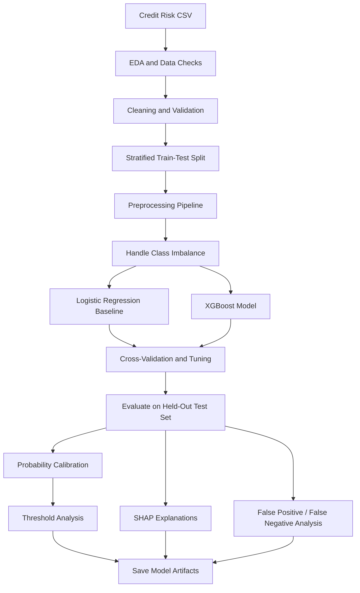

# Explainable Credit Risk Assessment

An end-to-end machine learning project that predicts loan default risk and explores how model predictions can be explained using SHAP (SHapley Additive exPlanations).

> **Project status:** Portfolio / learning project. The notebook includes data exploration, preprocessing, model comparison, hyperparameter tuning, calibration, SHAP explanations, error analysis, and model saving. It should not be used to make real lending decisions without further validation, testing, governance, and review.

## Table of Contents

- [Overview]
- [Business Problem]
- [Objectives]
- [Dataset]
- [Features Used]
- [Project Workflow]
- [Models and Techniques]
- [Evaluation Results]
- [Explainability with SHAP]
- [Project Structure]
- [Installation and Setup]
- [Running the Notebook]
- [Saved Artifacts]
- [Important Notes and Limitations]
- [Future Improvements]
- [Technologies Used]

## Overview

Credit risk assessment helps lenders estimate whether a borrower may fail to repay a loan. This project uses applicant and loan-related information to classify loan applications into two target classes:

- `0` — non-default
- `1` — default

The notebook develops and evaluates a Logistic Regression baseline and an XGBoost classifier. It also uses SHAP to investigate which input features influence predictions globally and for an individual applicant.

The model output is an estimate based on the data used to train it; it is not a guarantee of whether a borrower will repay.

## Business Problem

Lenders need to identify potentially risky loans while avoiding unnecessarily classifying reliable borrowers as high risk. A model that predicts only the majority class can miss many default cases, so evaluation should consider precision, recall, F1-score, ROC-AUC, and the costs of different types of mistakes—not accuracy alone.

This project explores that problem using a binary classification approach.

## Objectives

- Explore and understand the credit-risk dataset.
- Identify missing values, duplicates, unusual records, and class imbalance.
- Build reproducible preprocessing pipelines for numerical and categorical features.
- Establish Logistic Regression as a baseline.
- Train and tune XGBoost and compare its performance with the baseline.
- Evaluate classification performance using multiple metrics.
- Explore probability calibration and classification-threshold selection.
- Explain model predictions using global and local SHAP visualizations.
- Analyze false-positive and false-negative predictions.
- Save a trained model and a threshold artifact for potential downstream use.

## Dataset

The notebook expects a CSV file named **`credit_risk_dataset.csv`** in the working directory.

The notebook code uses the `loan_status` column as the target. It references the following applicant and loan-related fields:

- `person_age`
- `person_income`
- `person_emp_length`
- `loan_amnt`
- `loan_int_rate`
- `loan_percent_income`
- `cb_person_cred_hist_length`
- `person_home_ownership`
- `loan_intent`
- `loan_grade`
- `cb_person_default_on_file`
- `loan_status` (target)

**Dataset source:** The source URL and license are not specified in the notebook. Add the original dataset link and license here before publishing the repository. Do not upload private, confidential, or personally identifiable borrower data.

## Features Used

The notebook separates the features into two groups.

### Numerical features

- Applicant age
- Annual income
- Employment length
- Loan amount
- Loan interest rate
- Loan amount as a proportion of income
- Credit history length

### Categorical features

- Home ownership
- Loan purpose
- Loan grade
- Previous default-on-file indicator

### Target

`loan_status` is used as the binary target: `0` for non-default and `1` for default, as described in the notebook.

## Project Workflow

The diagram below gives a high-level view of the notebook. GitHub renders Mermaid diagrams as a visual flowchart. The expandable sections beneath it explain **what each stage does, why it matters, and what it produces**.



> **Important:** This is a workflow overview, not proof that every stage is currently correct. The threshold-search formula and inconsistent use of tuned versus untuned XGBoost models are known issues described in [Saved Artifacts](#saved-artifacts). Fix and rerun those cells before relying on the threshold or final explanations.

<details>
<summary><strong>1. Data loading and exploratory data analysis (EDA) — Why?</strong></summary>

**What happens:** Load `credit_risk_dataset.csv`; inspect row/column counts, data types, missing values, target distribution, numerical distributions, potential outliers, and correlations.

**Why it matters:** EDA (exploratory data analysis) helps reveal data-quality issues, class imbalance, unusual patterns, and relationships that should be understood before training a model.

**Output:** An initial understanding of the dataset and a list of data issues to investigate. EDA alone does not prove that a relationship is causal.

</details>

<details>
<summary><strong>2. Data validation and cleaning — Why?</strong></summary>

**What happens:** Check duplicates and implausible values; the notebook applies age and employment-length filters and checks loan-related fields.

**Why it matters:** Invalid or duplicated records can distort model learning and evaluation. Cleaning rules should be justified; an unusual value is not automatically an error.

**Output:** A dataset prepared for modeling, subject to review of the notebook's cleaning assumptions.

</details>

<details>
<summary><strong>3. Stratified train-test split — Why?</strong></summary>

**What happens:** Separate input features from `loan_status`, then split records into training and test sets using an 80/20 split and stratification.

**Why it matters:** The training set is used to fit models. The held-out test set estimates performance on unseen records. Stratification helps preserve the approximate proportion of default and non-default examples in each split.

**Output:** Separate training and test data. Preprocessing and model selection should be fitted using training data only, so information from the test set does not leak into training.

</details>

<details>
<summary><strong>4. Preprocessing with Pipeline and ColumnTransformer — Why?</strong></summary>

**What happens:** Fill missing numerical values using the median, scale numerical features for Logistic Regression, and one-hot encode categorical features. A `ColumnTransformer` applies suitable transformations to different columns, while a `Pipeline` connects preprocessing with the estimator.

**Why it matters:** Most ML estimators require numerical inputs and may not handle missing values. A pipeline makes the transformations repeatable and helps prevent train/test preprocessing leakage when fitted correctly.

**Output:** A consistent transformation-and-model workflow that can be fitted on training data and applied to test data or new records.

</details>

<details>
<summary><strong>5. Class-imbalance handling — Why?</strong></summary>

**What happens:** The notebook uses class weighting for Logistic Regression and a positive-class weight for XGBoost.

**Why it matters:** If defaults are less common than non-defaults, a model may favor the majority class and miss risky loans. Class weighting increases the training penalty for mistakes on the class of interest.

**Output:** Models trained with additional emphasis on default cases. The effect must still be measured with precision, recall, F1-score, and business-relevant error costs.

</details>

<details>
<summary><strong>6. Logistic Regression baseline — Why?</strong></summary>

**What happens:** Train Logistic Regression as an initial binary classifier.

**Why it matters:** A baseline gives a reference point. A more complex model should be judged against a simpler model rather than assumed to be better.

**Output:** Initial performance metrics for comparison with XGBoost.

</details>

<details>
<summary><strong>7. XGBoost, cross-validation, and hyperparameter search — Why?</strong></summary>

**What happens:** Train an XGBoost classifier, use stratified five-fold cross-validation, and search parameter combinations with `RandomizedSearchCV`, scoring candidates using average precision.

**Why it matters:** XGBoost can learn nonlinear patterns and feature interactions. Cross-validation evaluates candidates across multiple folds, while hyperparameter search tests settings such as tree complexity and learning rate.

**Output:** A selected estimator and cross-validation results. The held-out test set should not be used to choose hyperparameters.

</details>

<details>
<summary><strong>8. Held-out model evaluation — Why?</strong></summary>

**What happens:** Compare accuracy, precision, recall, and F1-score; inspect classification reports, confusion matrices, and precision-recall curves.

**Why it matters:** Accuracy alone can hide missed defaults. Precision reflects how often predicted defaults are actual defaults; recall reflects how many actual defaults are found; F1 combines precision and recall.

**Output:** A more complete view of model performance and the types of mistakes it makes on the held-out data.

</details>

<details>
<summary><strong>9. Probability calibration and threshold analysis — Why?</strong></summary>

**What happens:** The notebook attempts sigmoid calibration and explores a decision threshold for converting predicted probabilities into class labels.

**Why it matters:** Calibration asks whether predicted probabilities align with observed frequencies. The threshold controls the trade-off between false positives and false negatives; 0.50 is not automatically the best threshold for every use case.

**Output:** Potentially calibrated probabilities and a candidate threshold. **The current threshold-search code has a formula error, so its saved threshold is not validated.** Correct the F1 formula, use the selected tuned estimator consistently, and choose the threshold on validation data before reporting a final result.

</details>

<details>
<summary><strong>10. SHAP explainability — Why?</strong></summary>

**What happens:** Generate a global SHAP summary plot and a local SHAP waterfall plot for a selected example.

**Why it matters:** Global explanations summarize which features influence model outputs across examples. Local explanations show how feature contributions move an individual prediction away from the model's baseline output.

**Output:** Visual explanations of model behavior. SHAP values do not prove causation or establish that a feature is appropriate for lending decisions. Ensure explanations are generated from the same final estimator used for evaluation.

</details>

<details>
<summary><strong>11. False-positive and false-negative analysis — Why?</strong></summary>

**What happens:** Inspect false positives (non-default cases predicted as default) and false negatives (default cases predicted as non-default).

**Why it matters:** These errors can have different consequences. False positives may unnecessarily flag reliable borrowers, while false negatives may fail to identify borrowers who default.

**Output:** Examples and patterns to investigate, helping guide threshold selection and future model improvements.

</details>

<details>
<summary><strong>12. Model persistence with Joblib — Why?</strong></summary>

**What happens:** Save the model and threshold artifact with `joblib`.

**Why it matters:** Persistence lets a trained estimator be loaded later without retraining. For reliable reuse, the saved object must match the model that was evaluated, and preprocessing must be included where required.

**Output:** Reusable files such as `credit_risk_model.pkl` and `best_threshold.pkl`. The threshold artifact from the current notebook should not be used until the threshold bug and estimator inconsistency are fixed and the workflow is rerun.

</details>

## Models and Techniques

| Model / technique | Purpose |
|---|---|
| Logistic Regression | Baseline binary classifier |
| XGBoost Classifier | Tree-boosting model for nonlinear patterns |
| `Pipeline` | Connect preprocessing steps and estimator |
| `ColumnTransformer` | Apply different transformations to different column types |
| Median imputation | Fill missing numerical values |
| One-hot encoding | Convert categorical variables into numerical indicator features |
| StandardScaler | Standardize numerical features for Logistic Regression |
| Stratified train-test split | Preserve approximate target-class proportions |
| Stratified 5-fold cross-validation | Evaluate models across multiple folds |
| RandomizedSearchCV | Search combinations of XGBoost hyperparameters |
| Class weighting | Give additional importance to the minority class during training |
| Sigmoid calibration | Adjust predicted probabilities |
| SHAP | Explain feature contributions to predictions |
| Confusion matrix and classification metrics | Evaluate model errors and performance |
| Joblib | Save model and threshold artifacts |

## Evaluation Results

The notebook's recorded held-out test-set results are shown below. The test set contains **6,305 records** in the recorded outputs.

| Metric | Logistic Regression baseline | Tuned XGBoost |
|---|---:|---:|
| Accuracy | 0.82 | 0.92 |
| Precision (default class) | 0.56 | 0.81 |
| Recall (default class) | 0.79 | 0.81 |
| F1-score (default class) | 0.65 | 0.81 |

The notebook also reports a five-fold cross-validation ROC-AUC of approximately **0.871 for Logistic Regression** and **0.939 for XGBoost**.

### Interpreting the results

- **Accuracy** measures the fraction of all test records classified correctly.
- **Precision** measures how often a predicted default is actually a default.
- **Recall** measures how many actual defaults the model identifies.
- **F1-score** combines precision and recall.
- **ROC-AUC** measures how well the model ranks positive cases above negative cases across classification thresholds.

In the recorded evaluation, tuned XGBoost performs better than the Logistic Regression baseline on the listed test metrics. These results are specific to this dataset and experimental setup; they do not establish real-world lending performance.

## Explainability with SHAP

SHAP is used to make model behavior easier to inspect.

- **Global explanation:** The summary plot shows which transformed features have the greatest influence across the evaluated records.
- **Local explanation:** The waterfall plot shows how features contribute to a selected applicant's model output.

SHAP values explain the model's behavior; they do not prove causation or establish that a feature is appropriate for lending decisions.

## Project Structure

A recommended repository structure is:

```text
credit-risk-assessment/
├── Credit_Risk.ipynb
├── credit_risk_dataset.csv   # Add locally if permitted by its license
├── README.md
├── requirements.txt
└── .gitignore
```

Do not commit sensitive data or generated model files unless there is a clear reason and it is safe and permitted to publish them. The notebook saves `credit_risk_model.pkl` and `best_threshold.pkl` when the relevant cells run; these can be regenerated.

## Installation and Setup

### 1. Clone the repository

Replace `YOUR-USERNAME` with your GitHub username:

```bash
git clone https://github.com/YOUR-USERNAME/credit-risk-assessment.git
cd credit-risk-assessment
```

### 2. Create a virtual environment (recommended)

**Windows:**

```bash
python -m venv .venv
.venv\Scripts\activate
```

**macOS / Linux:**

```bash
python3 -m venv .venv
source .venv/bin/activate
```

### 3. Install dependencies

Create a `requirements.txt` file with the following packages:

```text
numpy
pandas
matplotlib
seaborn
scikit-learn
xgboost
shap
joblib
jupyter
ipykernel
scipy
```

Then install them:

```bash
pip install -r requirements.txt
```

These are package names rather than a fully pinned, tested environment. For reproducible results, test the notebook and pin the exact working package versions in `requirements.txt`.

### 4. Add the dataset

Place `credit_risk_dataset.csv` in the same directory as the notebook, or update the CSV path in the data-loading cell. Make sure you have permission to use and redistribute the dataset.

## Running the Notebook

Start Jupyter:

```bash
jupyter notebook
```

Open `Credit_Risk.ipynb` and run the cells from top to bottom.

The notebook includes package-installation commands for XGBoost and SHAP. If you use a local environment, install the dependencies first and remove or skip notebook-specific `!pip install` commands if they are unnecessary.

## Saved Artifacts

The notebook saves:

- `credit_risk_model.pkl` — a sigmoid-calibrated model built from the tuned estimator.
- `best_threshold.pkl` — a threshold value produced by the notebook's threshold-search section.


## Technologies Used

- **Python**
- **Pandas** and **NumPy** — data manipulation
- **Matplotlib** and **Seaborn** — visualization
- **Scikit-learn** — preprocessing, pipelines, cross-validation, model evaluation, hyperparameter search, and calibration
- **XGBoost** — gradient-boosted trees
- **SHAP** — model explainability
- **Joblib** — model persistence
- **Jupyter Notebook** — experimentation and documentation

---

## LinkedIn
https://www.linkedin.com/in/pramod-sharma-a8001a28b/?isSelfProfile=true

